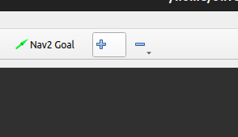
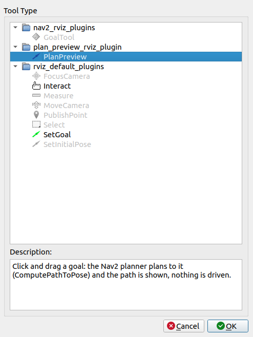
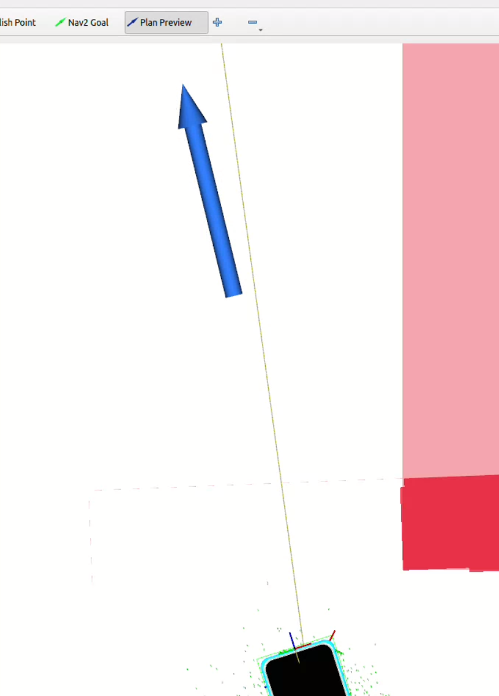

# nav2_plan_preview

RViz tool "Plan Preview": click and drag a goal, and the Nav2 planner plans a path there from the robot's current pose. The path is shown, but nothing is driven. Works with any Nav2 setup.

## How to use

In RViz:

1. Toolbar `+` → `nav2_plan_preview/PlanPreview` (shortcut `v`).

   

   

2. `Add` → `Path`, topic `/plan_preview`, Durability `Transient Local`.
3. Pick the tool, click the goal, drag for the heading. The status bar shows poses, length and planning time.

   

Tool properties: `Action` (default `/compute_path_to_pose`), `Planner ID` (empty = default planner), `Topic` (default `/plan_preview`).

Note: the planner server also puts each preview on `/plan`, so a `/plan` display shows it briefly; the robot keeps driving its own path.
